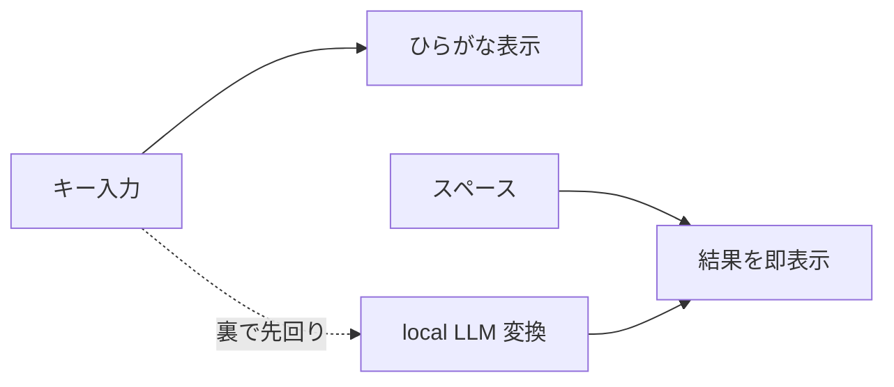

<div align="center">

# ⚡ Hayate

**打った瞬間、もう変換されている。**

azooKey の 10 倍以上速い、local LLM 日本語入力 for macOS


</div>

<br/>

|  | azooKey | **Hayate** |  |
|---|---:|---:|:---:|
| キー入力の待ち | 2.6 ms | **0.2 ms** | **13×** |
| スペース → 変換 | 5.1 ms | **0.2 ms** | **25×** |

<sub>中央値・M4 Max・同じ変換エンジンとモデルで計測</sub>

<br/>

## ⚡ なぜ速いか

local LLM の変換を、打鍵ごとに裏で先回りしておく。だからキー入力は止まらず、スペースを押した瞬間に結果が出る。



## ✨ 速さだけじゃない

- **文脈で選ぶ** — 「冷凍肉を」の後なら、かいとう は「解凍」
- **打ち間違いに強い** — `arigatpu` → ありがとうございます
- **迷った文節だけ選ぶ** — 確度の低い文節に、最初からフォーカス
- **完全オフライン** — 通信ゼロ。入力内容はログに残さない

## 📦 はじめる

```sh
./build.sh install
```

**システム設定 → キーボード → 入力ソース → ＋ → 日本語 (Hayate)**

> 更新したら、起動中のアプリを再起動してから切り替えてください。

## ⌨️ 操作

| キー | 動作 |
|---|---|
| `Space` | 変換・次の候補 |
| `↑` `↓` | 候補を選ぶ |
| `←` `→` | 文節を移動 |
| `Shift` `←` `→` | 文節の長さを変える |
| `1`–`9` | 番号で選ぶ |
| `Enter` | 確定 |
| `Esc` | 取り消す |

メニューバーの「あ」から、学習データのクリアとデバッグモードを使えます。

## 🆚 azooKey との違い

同じ変換エンジンを、呼び出し方から作り直しています。

|  | azooKey | **Hayate** |
|---|---|---|
| 1 位候補 | 学習が優先 | **文脈が優先** |
| 打ち間違い | local LLM 使用時はオフ | **local LLM と両立** |
| 長文 | 先頭から順に確定 | **迷った文節に自動フォーカス** |
| 通信 | OpenAI 連携あり | **完全オフライン** |
| 機能 | 豊富 | 最小限 |

<details>
<summary><b>開発者向け</b></summary>

<br/>

| パス | 役割 |
|---|---|
| [`Sources/HayateCore`](Sources/HayateCore/Engine.swift) | 変換エンジン：先回り実行・候補マージ・文節分割 |
| [`Sources/Hayate`](Sources/Hayate) | IME 本体と候補ウィンドウ |
| [`Sources/bench`](Sources/bench/main.swift) | ベンチ兼回帰テスト |

```sh
swift build -c release --product bench
D=.build/checkouts/AzooKeyKanaKanjiConverter/Sources/KanaKanjiConverterModuleWithDefaultDictionary
.build/release/bench $D/azooKey_dictionary_storage/Dictionary \
  $D/azooKey_emoji_dictionary_storage/EmojiDictionary/emoji_all_E16.0.txt models/zenz.gguf --azookey
```

`--azookey` は azooKey 既定設定の呼び出し方との速度比較。`--probe "<左文脈>" "<ローマ字>"` で 1 文を調べられます。

</details>

## 🙏 クレジット

[AzooKeyKanaKanjiConverter](https://github.com/azooKey/AzooKeyKanaKanjiConverter) · [azooKey_dictionary_storage](https://github.com/ensan-hcl/azooKey_dictionary_storage) · [zenz-v3.2-small](https://huggingface.co/Miwa-Keita/zenz-v3.2-small-gguf) · [azooKey-Desktop](https://github.com/azooKey/azooKey-Desktop)

## 📄 ライセンス

[MIT](LICENSE)
