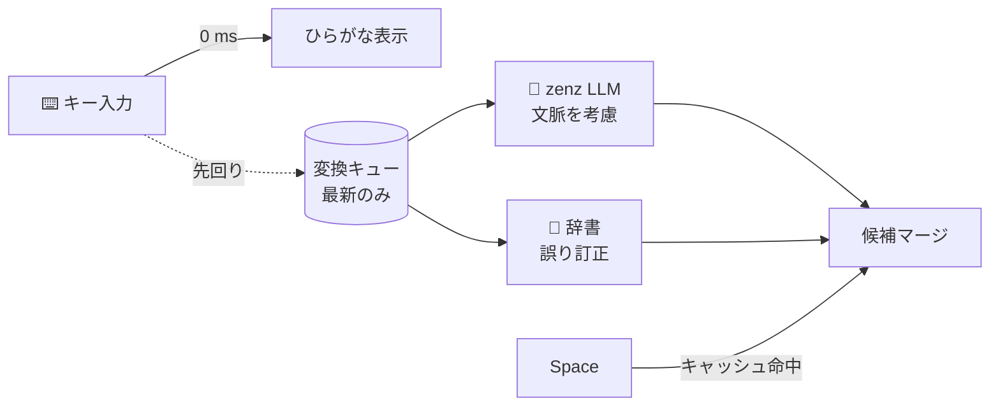

<div align="center">

# ⚡ Hayate <sub>疾風</sub>

**打鍵を一切待たせない、LLM 搭載の macOS 日本語入力**


</div>

---

## ✨ 特長

- 🚀 **タイピングが止まらない** — LLM 変換は打鍵ごとに裏で先回り。スペースを押した瞬間には変換が終わっている
- 🧠 **文脈で選ぶ** — カーソル左の文章を かな漢字変換 LLM [zenz-v3.2](https://huggingface.co/Miwa-Keita/zenz-v3.2-small-gguf) に渡す
- 🩹 **打ち間違いに強い** — `arigatpu` → ありがとうございます
- 🎯 **迷った文節に自動でフォーカス** — LLM と辞書の候補が食い違う文節だけを最初から選択状態に。確実な文はまるごと 1 文節
- 🔒 **完全オフライン** — 実行時の通信ゼロ、入力内容はログに残さない

## 📊 ベンチマーク <sub>M4 Max</sub>

|  | 打鍵ごとの待ち | スペース → 候補 |
|---|---|---|
| 従来方式（LLM を打鍵ごとに同期実行） | p50 6.5 ms / 最大 28 ms | — |
| **Hayate** | **0 ms**（バックグラウンド） | **0.2 ms** |

精度テスト 8/10 正解（[`Sources/bench`](Sources/bench/main.swift)）

## 📦 インストール

```sh
./build.sh install
```

**システム設定 → キーボード → 入力ソース → ＋ → 日本語 → 日本語 (Hayate)** を追加して、メニューバーの「あ」を選べば完了。

> 💡 初回は依存パッケージとモデル（70 MB）の取得で数分かかります。Apple Silicon + Xcode（Swift 6.1 以上）が必要です。

> ⚠️ **更新（再インストール）したら、起動中のアプリを再起動してから Hayate に切り替えてください。** 古い入力ソース情報を持ったままのアプリ（Ghostty、Discord など）は、切り替えた瞬間に macOS 側で落ちることがあります。ログアウト→ログインが一番確実です。

## ⌨️ キー操作

| キー | 動作 |
|---|---|
| `Space` | 変換 / 選択中の文節の次の候補 |
| `↑` `↓` | 候補を選ぶ |
| `←` `→` | 文節を移動（文全体のときは文節に分割） |
| `Shift` + `←` `→` | 文節の範囲を調整 |
| `1`–`9` | 番号で選んで次の文節へ |
| `Enter` | すべて確定 |
| `Esc` / `⌫` | 変換を取り消す |
| `英数` / `かな` | モード切替 |

## 🏗️ しくみ



| パス | 役割 |
|---|---|
| [`Sources/HayateCore`](Sources/HayateCore/Engine.swift) | 変換エンジン（専用キュー・先回り実行・候補マージ） |
| [`Sources/Hayate`](Sources/Hayate) | IME 本体（InputMethodKit）と候補ウィンドウ |
| [`Sources/bench`](Sources/bench/main.swift) | 速度・精度ベンチ兼回帰テスト |

<details>
<summary>🧪 ベンチを回す</summary>

```sh
swift build -c release --product bench
D=.build/checkouts/AzooKeyKanaKanjiConverter/Sources/KanaKanjiConverterModuleWithDefaultDictionary
.build/release/bench $D/azooKey_dictionary_storage/Dictionary \
  $D/azooKey_emoji_dictionary_storage/EmojiDictionary/emoji_all_E16.0.txt models/zenz.gguf
```

1 文だけ調べるなら末尾に `--probe "<左文脈>" "<ローマ字>"`。
</details>

## 🔒 プライバシー

- 実行時のネットワーク通信なし（通信 API をリンクしていないことを確認済み）
- システムログに出すのは起動・有効化のイベントだけ。入力した文字は記録しない
  - 例外：入力メニューの **デバッグモード** をオンにしたときだけ、文脈と候補を記録（既定はオフ）
- 保存するのは確定した単語の学習データのみ → `~/Library/Application Support/Hayate/`
  - 入力メニューの **学習データをクリア…** で消去できます
- 1 位候補は文脈で決め、学習は 2 位以降に反映（学習が文脈を上書きしない）

## 🙏 クレジット

| | ライセンス | 用途 |
|---|---|---|
| [AzooKeyKanaKanjiConverter](https://github.com/azooKey/AzooKeyKanaKanjiConverter) | MIT | 変換エンジン |
| [azooKey_dictionary_storage](https://github.com/ensan-hcl/azooKey_dictionary_storage) | Apache-2.0 | 辞書 |
| [zenz-v3.2-small](https://huggingface.co/Miwa-Keita/zenz-v3.2-small-gguf) | Apache-2.0 | かな漢字変換 LLM |
| [azooKey-Desktop](https://github.com/azooKey/azooKey-Desktop) | MIT | 記号の全角化テーブル |

## 📄 ライセンス

[MIT](LICENSE)（依存・モデルはそれぞれのライセンスに従います）
